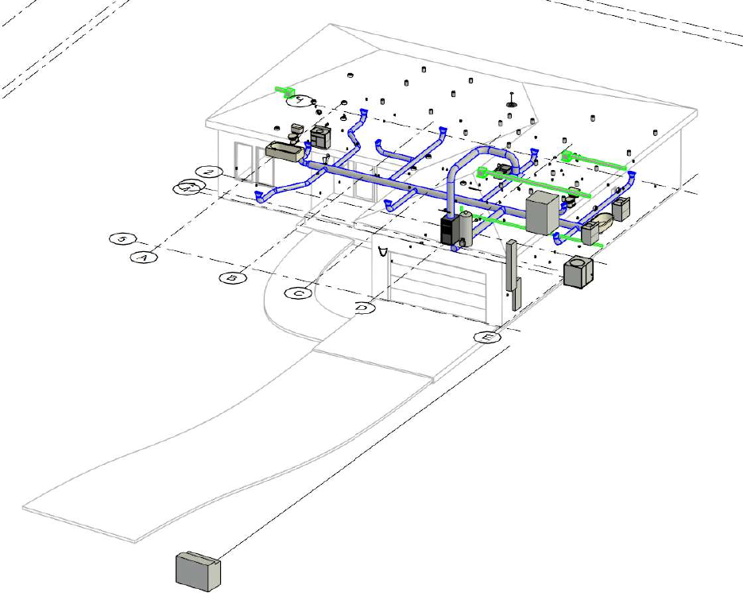
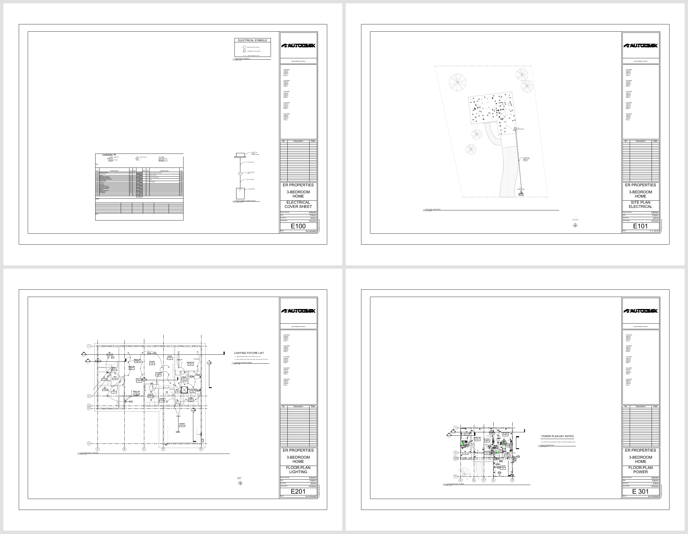
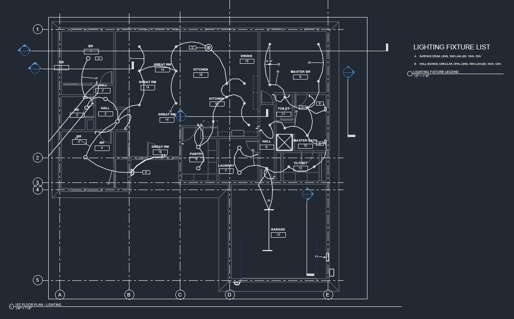
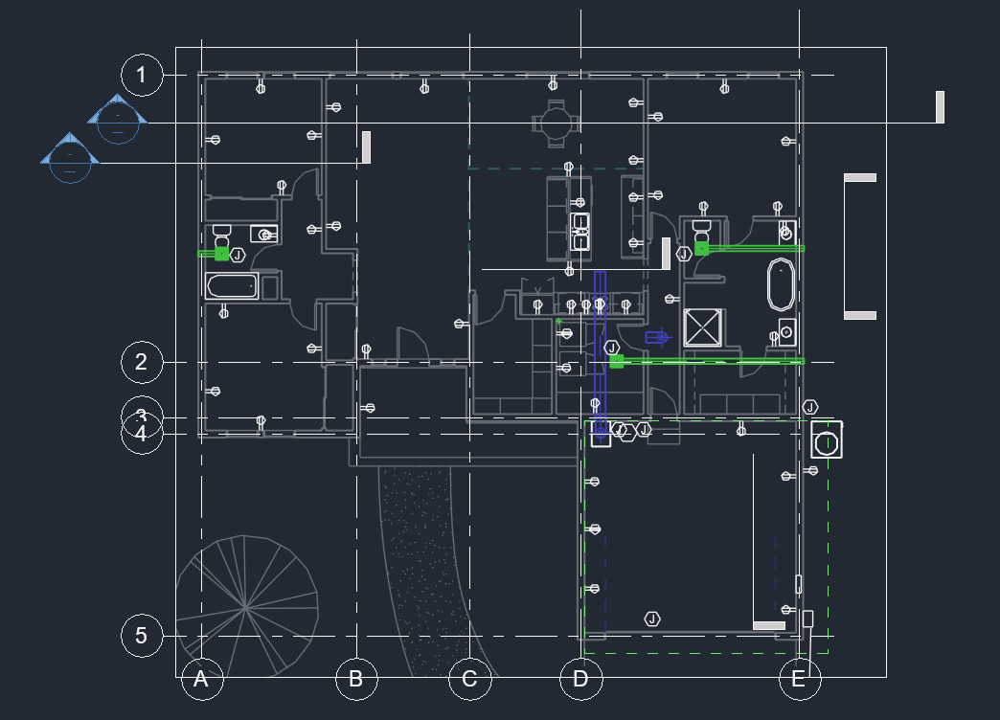
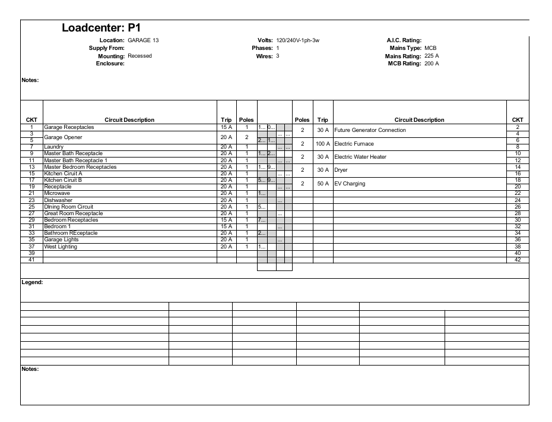
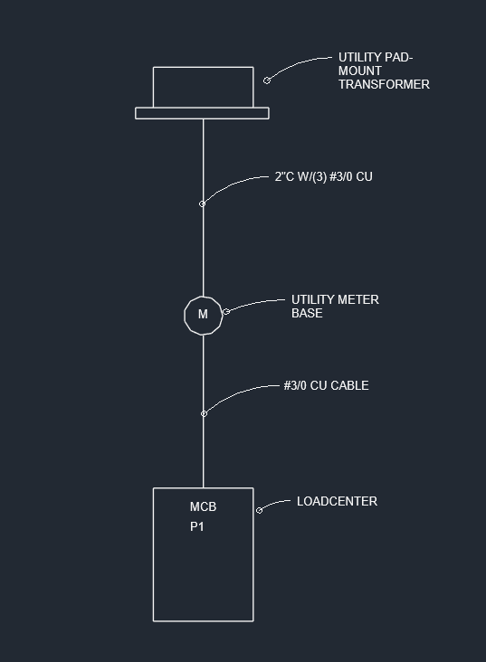

# Revit MEP Electrical – 3-Bedroom Home

A complete residential electrical design in Autodesk Revit, from a blank project to a
printed sheet set. Beginner project, built in **November 2026** by following a
5½-hour start-to-finish tutorial (see [Reference](#reference)).



## Sheet set
| Sheet | Title |
|---|---|
| [E100](sheets/E100_Electrical-Cover-Sheet.pdf) | Electrical Cover Sheet: symbols, panel schedule, one-line diagram |
| [E101](sheets/E101_Site-Plan-Electrical.pdf) | Site Plan – Electrical: meter, utility transformer, underground service |
| [E201](sheets/E201_Floor-Plan-Lighting.pdf) | Floor Plan – Lighting: fixtures, switching, lighting circuits |
| [E301](sheets/E301_Floor-Plan-Power.pdf) | Floor Plan – Power: receptacles, equipment connections, key notes |



## What I built
- **Power:** 120 V duplex receptacles plus 240 V outlets, laid out room by room, with
  connections to HVAC and plumbing equipment from the linked mechanical model
- **Lighting:** surface, recessed, and wall-mount fixtures with switches and switch legs
- **Distribution:** loadcenter P1 (120/240 V, 1-phase, 3-wire, 200 A main breaker) with
  every circuit assigned and a panel schedule
- **Service:** utility pad-mount transformer → meter base → loadcenter, shown on a
  one-line diagram and on the site plan as an underground service lateral
- **Documentation:** coordination views, view templates, filters, symbol legend,
  lighting fixture list, keyed notes, and title-blocked sheets

| Lighting plan with switching | Power coordination view |
|---|---|
|  |  |

| Panel schedule – P1 | One-line diagram |
|---|---|
|  |  |

## Repo layout
```
sheets/    Printed sheets (E100–E301)
views/     Individual plan, RCP, 3D, and one-line views exported as PDF
legends/   Electrical symbols, lighting fixture list, power plan key notes
images/    Screenshots used in this README
model/     Electrical_3-Bedroom_Home.rvt (my electrical model)
```

> **Note:** The electrical model links to the tutorial's architectural and mechanical
> models, which aren't included here. Download them from the tutorial link below to open
> the model with its links loaded.

## Tools
Autodesk Revit (Autodesk Education license)

## Reference
- Tutorial: [Entire House! – REVIT MEP ELECTRICAL Full Course Start to Finish](https://www.youtube.com/watch?v=it5oK6iwgJg)
  by MFIA Inc. Consulting Engineers
- Starter architectural/mechanical models and electrical template: [MFIA download page](https://www.mfia-eng.com/offers/yq2FF8sf/checkout)
